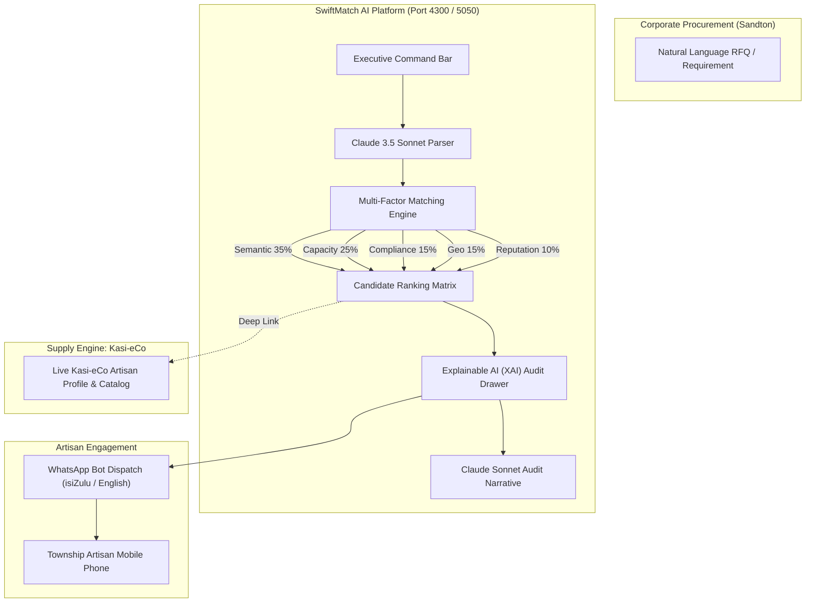

# ⚡ SwiftMatch AI — Enterprise Demand & Township SME Matching Engine

> **YES AI Hackathon 2026** • **Challenge 4: ESD Tech Enablement**  
> *Developed on-site at WeWork Sandton, Johannesburg (23–24 October 2026)*  
> *Track: Enterprise Supplier Development (ESD) & Youth Economic Inclusion*

---

## 📌 Executive Summary

South Africa's Top 100 Corporates spend over **R40 Billion annually** on Enterprise & Supplier Development (ESD) and preferential procurement. Yet, procurement managers struggle with a 6-week administrative bottleneck to discover, verify, and match compliant township makers. Simultaneously, over **60% of youth-owned township artisans** operate solely through WhatsApp without visibility on corporate ERPs like SAP Ariba or Coupa.

**SwiftMatch AI** bridges this chasm:
1. **Corporate Demand-Side Intelligence:** Natural-language RFQ ingestion parsed with **Anthropic Claude 3.5 Sonnet**.
2. **Multi-Factor Semantic Matching:** Deterministic 5-factor scoring engine (Semantic Fit 35%, Production Capacity 25%, Compliance 15%, Geographic Proximity 15%, Verified Reputation 10%).
3. **Responsible AI & Explainability:** Transparent breakdown of scores with delivery & compliance risk advisories.
4. **WhatsApp-Native Artisan Dispatch:** Instant dispatch of RFQs to makers via WhatsApp with bilingual tone adaptation (isiZulu / English).
5. **Supply-Side Backbone:** Deep-linked to the verified grassroots marketplace catalog on [Kasi-eCo](http://localhost:4200).

---

## 📋 Hackathon Rule 1.2 Compliance Disclosure

Per Hackathon Rules Section 1.2 on pre-existing work and third-party tools:

### 1. Pre-Existing Work (Prior to Hackathon)
- **Kasi-eCo Marketplace Baseline:** The grassroots e-commerce platform codebase (Angular 16 frontend template and theme foundations) developed under the Swift House initiative.
- **Initial Artisan Data Schema:** High-level entity structure of township artisans and craft categories.

### 2. Developed During the Hackathon (On-Site at WeWork Sandton)
- **SwiftMatch AI Matching Engine (`matchingEngine.js`):** Custom 5-factor weighted deterministic scoring algorithm with Haversine distance calculations and capacity ratio curves.
- **Anthropic Claude Integration (`claudeEngine.js`):**
  - Prompt extraction pipeline for unstructured corporate procurement RFQs (`/api/claude/parse-rfq`).
  - Explainable AI (XAI) natural language audit trail generation (`/api/claude/explain`).
  - Tone-adaptive, bilingual artisan WhatsApp message composer (`/api/claude/whatsapp`).
- **Dark Obsidian "Afro-Enterprise Dark Glass" UI:** Complete corporate executive command bar, live candidate card ranking, real-time conic gradient score meters, XAI audit drawer, and simulated smartphone WhatsApp dispatch viewer.
- **YES Ecosystem Impact Macro Dashboard:** Visualizing aggregate procurement volumes, youth jobs sustained, sector demand percentages, and systemic township capability gaps.
- **Standalone Express Backend Server (`server.js`):** Port 5050 REST API orchestrating the matching, Claude AI, and ecosystem telemetry.

### 3. Third-Party AI Models, APIs & Libraries
- **Anthropic Claude 3.5 Sonnet (`@anthropic-ai/sdk`)**: LLM for structured RFQ parsing, transparency audit narratives, and tone-adaptive WhatsApp composition.
- **Antigravity (Google DeepMind)**: AI pair-programming assistant used during development.
- **Bootstrap 5 & Bootstrap Icons**: Frontend grid layout, responsive typography, and iconography.
- **Plus Jakarta Sans**: Typography via Google Fonts.
- **Node.js & Express**: Backend runtime and REST API framework.
- **Angular 16**: Reactive frontend client.

---

## 🏗️ Architecture Overview



---

## 🚀 Getting Started

### Prerequisites
- Node.js (v18+)
- npm (v9+)
- Angular CLI 16 (`npm install -g @angular/cli@16`)

### 1. Clone & Setup Backend
```bash
cd c:\projects\SwiftMatch-AI\server
npm install
```

Configure your environment variables in `c:\projects\SwiftMatch-AI\server\.env`:
```env
PORT=5050
ANTHROPIC_API_KEY=sk-ant-api03-... # Your Anthropic API Key (optional — graceful fallback included)
```

Start the backend:
```bash
node server.js
# Listening on http://localhost:5050
```

### 2. Setup Frontend Client
```bash
cd c:\projects\SwiftMatch-AI\client
npm start -- --port 4300
# Available at http://localhost:4300
```

---

## 🎯 Verification Endpoints

| Endpoint | Method | Purpose |
|---|---|---|
| `/api/health` | GET | System health & engine status check |
| `/api/smes` | GET | List verified township SME supplier network |
| `/api/rfqs` | GET | Pre-configured corporate RFQ test cases |
| `/api/match` | POST | Execute multi-factor weighted matching matrix |
| `/api/claude/parse-rfq` | POST | Claude-powered structured RFQ extractor |
| `/api/claude/explain` | POST | Claude-powered XAI audit narrative generator |
| `/api/claude/whatsapp` | POST | Claude-powered bilingual WhatsApp composer |
| `/api/ecosystem/metrics` | GET | YES macroeconomic impact & gap telemetry |

---

## 👥 Authors & Team
- **Bulela Gomoshe** — Lead Architecture & Fullstack Engineering (`Swift House` / `Kasi-eCo`)
- Built for the **YES AI Hackathon 2026**, Johannesburg, South Africa.
